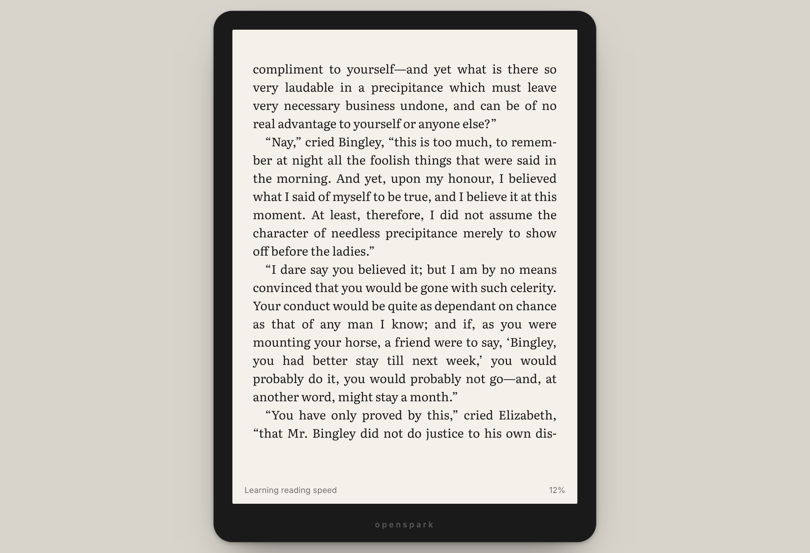
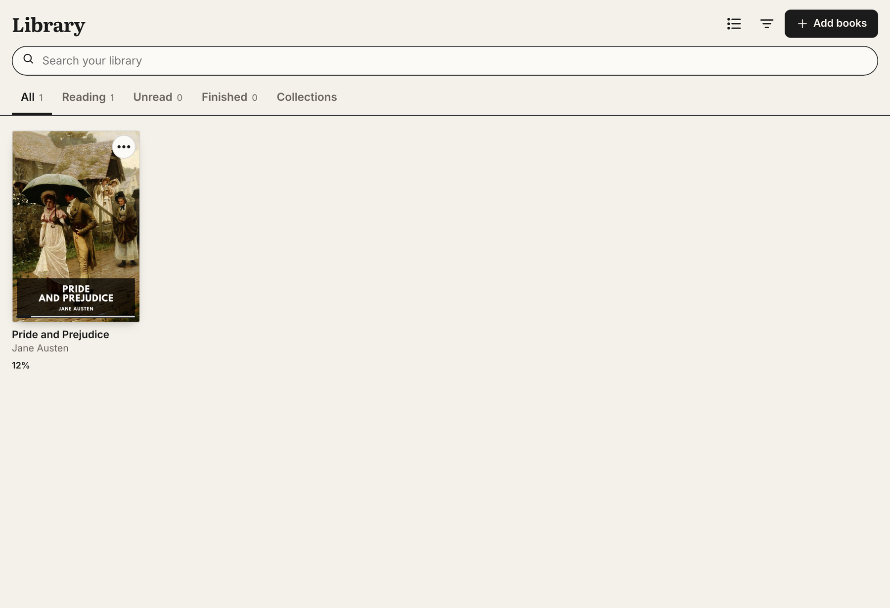
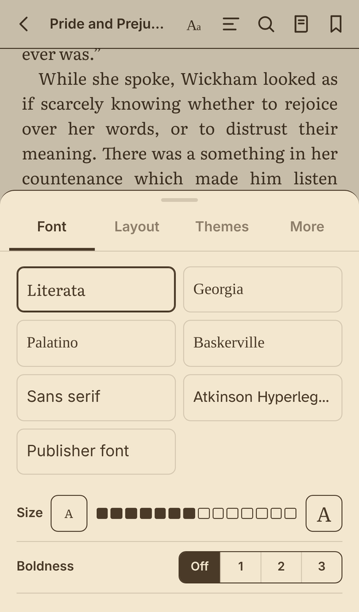

# OpenSpark

**A distraction-free e-reader with the look and feel of an e-ink screen. No store, no account, no cloud. Just your books.**

OpenSpark is a web app you open in a browser (or install as an app). Add your DRM-free
e-books, and they're arranged on a shelf and opened in a paper-like reading view. Tap to
turn pages, tap the top for the toolbar, and see "12 mins left in chapter" at the bottom.
Everything stays on your device.

<p align="center">
  
</p>

<p align="center">
  
  &nbsp;
  
</p>

## Features

**Formats:** EPUB, MOBI, AZW3/KF8, AZW (DRM-free), FB2, CBZ comics. Fixed-layout EPUBs work too.

**Reading**
- Paginated, paper-toned pages with e-ink-style chrome: flat, high contrast, no animation by default
- Tap zones: left edge goes back, the rest goes forward, the top strip opens the toolbar. Swipe, arrow keys, space and the mouse wheel also work
- Status line with **time left in chapter / book** (learned from your own reading speed), **location**, real **page numbers** when the book has them, and percent. Tap it to switch.
- Progress slider, table of contents, go to location or %, "previous position"
- Full-text search
- Highlights in four colors, notes, bookmarks (with the corner ribbon), all collected in a **Notebook**
- Export notes and highlights in the familiar `Clippings.txt` format
- Display settings: 6 fonts plus the publisher's own (Literata and Atkinson Hyperlegible bundled), 14 sizes, boldness, line spacing, margins, justification, hyphenation, one or two columns
- Themes: White, Paper, Sepia, Mint, Dark. Optional grayscale images, and an optional **e-ink refresh flash**
- A **device frame** on large screens so the page looks like a screen (Auto / On / Off)

**Library**
- Drag and drop or pick files; duplicates are detected
- Grid or list view; sort by recent, title, author, series or date added
- Filters: All, Reading, Unread, Finished
- **Collections**: create, rename, delete, add a book to several
- Generated covers for books without one; book details; mark as finished or unread

**Privacy and offline**
- Books, progress and notes are stored in your browser's IndexedDB. Nothing is uploaded.
- Works offline once loaded (service worker); installable as a PWA, which can then open e-book files from your OS
- Scripts embedded in books are blocked by a strict Content Security Policy

## What it deliberately doesn't do

No store, no sign-in, no sync, no recommendations, no ads. It also can't open
**DRM-protected** files (most books bought from online stores). Those are detected and you get
a clear message. Free, DRM-free books are available from sources like
[Standard Ebooks](https://standardebooks.org) and [Project Gutenberg](https://www.gutenberg.org).

## Run it

No build step, no dependencies. Any static file server works.

```sh
git clone https://github.com/adit-rah/openspark
cd openspark
npm start          # or: node serve.mjs 8080, or: python3 -m http.server 8080
```

Open <http://localhost:8080>. Use `localhost` or HTTPS: browsers only allow some of the
APIs the app uses (Web Crypto, service workers) in a secure context.

### Host it

The repo includes a GitHub Pages workflow (`.github/workflows/pages.yml`). Enable it under
**Settings → Pages → Source: GitHub Actions** and every push to `main` publishes the app.
Any other static host (Netlify, Cloudflare Pages, a Raspberry Pi) works the same way.

### Install on iPhone or iPad

OpenSpark is a Progressive Web App, so it installs straight from Safari with no App Store:

1. Host it over HTTPS (for example with the GitHub Pages workflow above) and open the URL in **Safari**.
2. Tap **Share** → **Add to Home Screen**.
3. Launch it from the home screen. It runs full screen, works offline, and its storage is
   exempt from Safari's 7-day cleanup of website data.

Add books with **Add books**: the iOS file picker lets you choose from Files, iCloud Drive
or other storage providers. iOS doesn't let web apps register as an "Open in…" target for
e-book files, so you can't send a book to OpenSpark from the share sheet; that would take
a native wrapper.

## Keyboard shortcuts

| Key | Action |
| --- | --- |
| `→` `↓` `Space` `PageDown` | Next page |
| `←` `↑` `Shift+Space` `PageUp` | Previous page |
| `Enter` / `M` | Show or hide the toolbar |
| `A` | Display settings |
| `G` / `T` | Go to / contents |
| `F` / `/` | Search |
| `N` | Notebook |
| `B` | Toggle bookmark |
| `Esc` | Close panel, then return to library |

## How it works

OpenSpark is plain HTML, CSS and JavaScript modules. Parsing and pagination come from
[foliate-js](https://github.com/johnfactotum/foliate-js) (MIT), vendored in
`vendor/foliate-js`. OpenSpark adds the library, the reading UI, settings, annotations
and storage. See [CONTRIBUTING.md](CONTRIBUTING.md) for a code map and how to run the tests.

## Credits and licenses

- OpenSpark: MIT, see [LICENSE](LICENSE)
- [foliate-js](https://github.com/johnfactotum/foliate-js): MIT (bundles zip.js, BSD-3-Clause, and fflate, MIT)
- [Literata](https://github.com/googlefonts/literata) and [Atkinson Hyperlegible](https://www.brailleinstitute.org/freefont/) fonts: SIL Open Font License 1.1 (see `fonts/`)

OpenSpark is an independent project. It is not affiliated with, endorsed by, or connected
to Amazon or Kindle. "Kindle" is a trademark of Amazon.com, Inc. or its affiliates.
